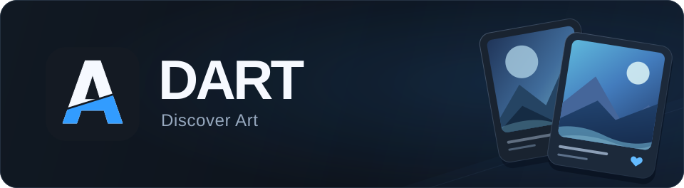

Browse **Danbooru**, **Gelbooru**, **Rule34 (R34)**, and **Sankaku** on Windows or Android.

[All releases](https://github.com/4ek1st/DART/releases) · [User guide](docs/GUIDE.md) · [Report an issue](https://github.com/4ek1st/DART/issues)

Windows x64 · Android 8.0+ · Internet connection required

## Everything in one place

- **Explore** — search by tags, discover popular posts, and filter by source.
- **Recommendations** — find art based on your likes, with favorite and excluded tags.
- **Following** — see new work from the artists you follow.
- **Your collection** — like works to shape recommendations, bookmark them for later, and keep your history and tabs.

The Android build is **DART 0.1.15**, with English, Russian and German interfaces.
Android and Windows have separate version numbers and share local recommendation,
curation and grouping rules. Both work independently. Use **Settings → Profile transfer**
to merge likes, bookmarks, follows and viewed works between devices without replacing
either profile. Credentials and device settings stay on their own device.

## Get started

1. Download the [Windows EXE](https://github.com/4ek1st/DART/releases/latest/download/DART.Windows.exe) or [Android APK](https://github.com/4ek1st/DART/releases/download/android-v0.1.15/DART.Android-0.1.15.apk).
2. Open the app settings and connect the sources you want to use.
3. Explore, save your favorites, and follow artists.

On Windows, install the [Microsoft Edge WebView2 Runtime](https://developer.microsoft.com/en-us/microsoft-edge/webview2).

---

[Sources and updates](docs/GUIDE.md) · [Android source](android/) · [For contributors](CONTRIBUTING.md)
